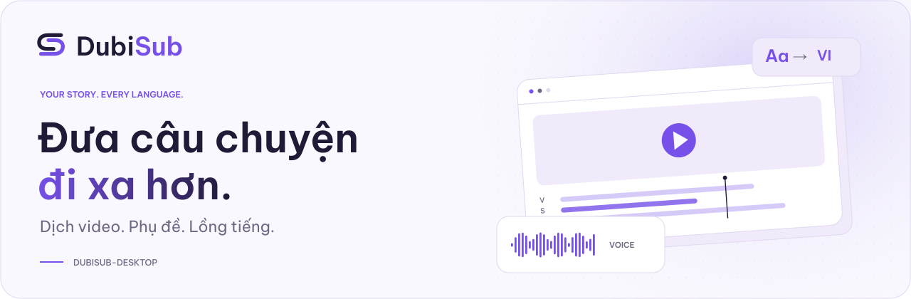

<picture>
  <source media="(prefers-color-scheme: dark)" srcset="https://raw.githubusercontent.com/DubiLabs/.github/3406c6956f4de1eab37a8a302ae9d374c8da9f35/profile/assets/dubilabs-banner-dark.svg">
  
</picture>

  <a href="#about-dubilabs">About</a> &nbsp;·&nbsp;
  <a href="#tiếng-việt">Tiếng Việt</a> &nbsp;·&nbsp;
  <a href="#product-showcase">Product showcase</a> &nbsp;·&nbsp;
  <a href="https://dubilabs.ericisme.cloud/">Website</a>

## About DubiLabs

DubiLabs is a software development organization working across AI, software engineering, and creative technology. We bring ideas from concept to implementation with a focus on clear design, reliable engineering, and practical use.

### Our direction

We explore how AI can support creative work while keeping people in control. We favor software that is straightforward to use, maintain, and improve over time.

## Tiếng Việt

DubiLabs là tổ chức phát triển phần mềm, hoạt động ở giao điểm giữa AI, kỹ thuật phần mềm và công nghệ sáng tạo. Chúng tôi đưa ý tưởng vào thực tế bằng thiết kế rõ ràng, kỹ thuật đáng tin cậy và sự chú trọng đến nhu cầu sử dụng.

### Định hướng

Chúng tôi tìm cách ứng dụng AI để hỗ trợ công việc sáng tạo và giữ quyền kiểm soát cho người dùng. DubiLabs ưu tiên phần mềm dễ sử dụng, dễ bảo trì và có thể tiếp tục cải tiến theo thời gian.

---

## Product showcase

<!-- Add future public products here, with a cover, platform, short description, and stable release links. -->

### DubiSub

<picture>
  <source media="(prefers-color-scheme: dark)" srcset="https://raw.githubusercontent.com/DubiLabs/.github/d8ff9b6151c5c869669ae75156636f3b59483fa1/profile/assets/hero-dark.svg">
  
</picture>

**Windows desktop** · Video translation, subtitling, and dubbing

Edit dialogue and subtitles, preview the result, and export the finished video from one workspace.

**[Download for Windows](https://github.com/DubiLabs/dubisub-releases/releases/latest)** · [Product website](https://dubi.ericisme.cloud/) · [User guide](https://github.com/DubiLabs/dubisub-releases/blob/main/docs/user-guide.md) · [Support](https://github.com/DubiLabs/dubisub-releases/issues)

Thông tin sản phẩm bằng tiếng Việt

DubiSub là ứng dụng Windows để dịch video, tạo phụ đề và lồng tiếng. Bạn có thể chỉnh lời thoại, xem trước kết quả và xuất video trong cùng một không gian làm việc.

**[Tải cho Windows](https://github.com/DubiLabs/dubisub-releases/releases/latest)** · [Hướng dẫn tiếng Việt](https://github.com/DubiLabs/dubisub-releases/blob/main/docs/user-guide.vi.md) · [Hỗ trợ](https://github.com/DubiLabs/dubisub-releases/issues)

