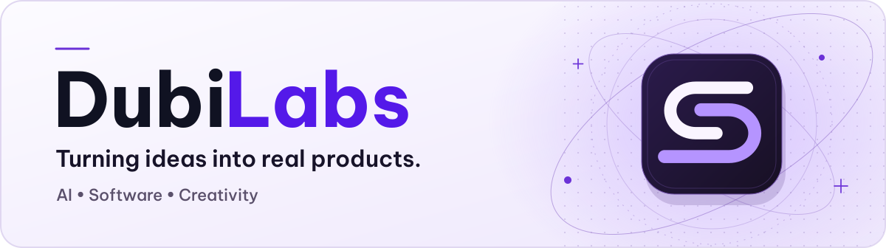

<picture>
  <source media="(prefers-color-scheme: dark)" srcset="https://raw.githubusercontent.com/DubiLabs/.github/main/profile/assets/dubilabs-banner-dark.svg">
  
</picture>

  <a href="#tiếng-việt">Tiếng Việt</a> &nbsp;·&nbsp;
  <a href="#english">English</a> &nbsp;·&nbsp;
  <a href="https://dubilabs.ericisme.cloud/">Website</a> &nbsp;·&nbsp;
  <a href="https://github.com/orgs/DubiLabs/repositories">Repositories</a>

## Tiếng Việt

DubiLabs phát triển phần mềm và công cụ AI cho công việc sáng tạo. Chúng tôi tập trung vào những bước tốn thời gian khi làm nội dung, để người dùng có thêm thời gian trau chuốt thành phẩm.

Video đa ngôn ngữ là hướng đầu tiên của DubiLabs. Trang này tập hợp các sản phẩm, tài liệu và bản phát hành công khai của tổ chức.

### Sản phẩm

<!-- Khi có sản phẩm công khai mới, thêm một mục ở cả phần tiếng Việt và tiếng Anh. Dùng liên kết ổn định tới trang sản phẩm, bản tải và tài liệu. -->

**DubiSub** · Ứng dụng Windows để dịch video, tạo phụ đề và lồng tiếng. Bạn có thể chỉnh lời thoại, xem trước và xuất thành phẩm trên máy của mình.

[Tải bản mới nhất](https://github.com/DubiLabs/dubisub-releases/releases/latest) · [Hướng dẫn](https://github.com/DubiLabs/dubisub-releases/blob/main/docs/user-guide.vi.md) · [Trang sản phẩm](https://dubi.ericisme.cloud/) · [Góp ý và báo lỗi](https://github.com/DubiLabs/dubisub-releases/issues)

## English

DubiLabs builds software and AI tools for creative work. We focus on the time-consuming parts of making content, so creators can spend more time shaping the result.

Multilingual video is where we started. This profile brings together the organization’s public products, documentation, and releases.

### Products

**DubiSub** · A Windows app for translating, subtitling, and dubbing video. Edit dialogue, preview the result, and export it on your own computer.

[Download the latest version](https://github.com/DubiLabs/dubisub-releases/releases/latest) · [User guide](https://github.com/DubiLabs/dubisub-releases/blob/main/docs/user-guide.md) · [Product website](https://dubi.ericisme.cloud/) · [Feedback and bug reports](https://github.com/DubiLabs/dubisub-releases/issues)

---

 &nbsp; DubiLabs · <a href="https://github.com/Ericismee">Ericismee</a>

