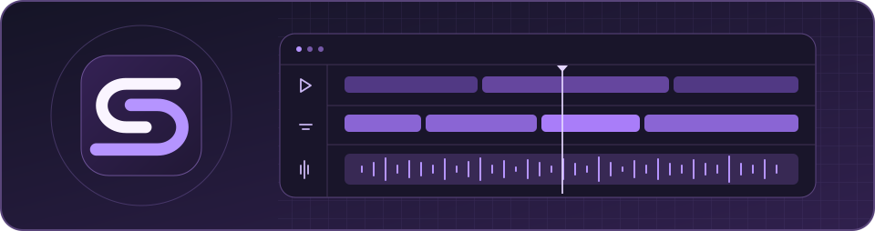

<picture>
  <source media="(prefers-reduced-motion: reduce) and (prefers-color-scheme: dark)" srcset="https://raw.githubusercontent.com/DubiLabs/.github/3406c6956f4de1eab37a8a302ae9d374c8da9f35/profile/assets/dubilabs-banner-dark.svg">
  <source media="(prefers-reduced-motion: reduce)" srcset="https://raw.githubusercontent.com/DubiLabs/.github/3406c6956f4de1eab37a8a302ae9d374c8da9f35/profile/assets/dubilabs-banner-light.svg">
  <source media="(prefers-color-scheme: dark)" srcset="https://raw.githubusercontent.com/DubiLabs/.github/main/profile/assets/dubilabs-en-motion-dark.svg">
  
</picture>

  <strong>English</strong> &nbsp;·&nbsp; <a href="https://github.com/DubiLabs/.github/blob/main/profile/README.vi.md">Vietnamese</a>
   
  <a href="#about-dubilabs">About</a> &nbsp;·&nbsp; <a href="#product-showcase">Product showcase</a> &nbsp;·&nbsp; <a href="https://dubilabs.ericisme.cloud/">Website</a>

## About DubiLabs

DubiLabs is a software development organization working across AI, software engineering, and creative technology. We turn ideas into tools that address practical needs and fit into everyday work.

### What guides our work

- **Purposeful AI.** Apply AI where it makes a task easier or gives people a useful capability.
- **Reliable engineering.** Build software that is clear to use, maintainable, and designed to improve over time.
- **Creative control.** Give people room to shape the process and decide what the finished work looks like.

---

## Product showcase

<!-- Add new public products here and in README.vi.md. Keep download links on the stable release channel. -->

### DubiSub

**Windows desktop** · Video translation, subtitling, and dubbing

Edit dialogue and subtitles, preview your changes, and export the finished video on your computer.

**[Download for Windows](https://github.com/DubiLabs/dubisub-releases/releases/latest)** · [Product website](https://dubi.ericisme.cloud/) · [User guide](https://github.com/DubiLabs/dubisub-releases/blob/main/docs/user-guide.md) · [Support](https://github.com/DubiLabs/dubisub-releases/issues)
