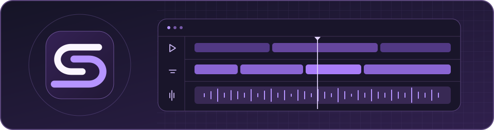

<picture>
  <source media="(prefers-reduced-motion: reduce) and (prefers-color-scheme: dark)" srcset="https://raw.githubusercontent.com/DubiLabs/.github/main/profile/assets/dubilabs-vi-static-dark.svg">
  <source media="(prefers-reduced-motion: reduce)" srcset="https://raw.githubusercontent.com/DubiLabs/.github/main/profile/assets/dubilabs-vi-static-light.svg">
  <source media="(prefers-color-scheme: dark)" srcset="https://raw.githubusercontent.com/DubiLabs/.github/main/profile/assets/dubilabs-vi-motion-dark.svg">
  
</picture>

  <strong>Tiếng Việt</strong> &nbsp;·&nbsp; <a href="https://github.com/DubiLabs">Tiếng Anh</a>
   
  <a href="#giới-thiệu-dubilabs">Giới thiệu</a> &nbsp;·&nbsp; <a href="#trưng-bày-sản-phẩm">Trưng bày sản phẩm</a> &nbsp;·&nbsp; <a href="https://dubilabs.ericisme.cloud/">Trang web</a>

## Giới thiệu DubiLabs

DubiLabs là tổ chức phát triển phần mềm trong các lĩnh vực trí tuệ nhân tạo, kỹ thuật phần mềm và công nghệ sáng tạo. Chúng tôi biến ý tưởng thành công cụ giải quyết nhu cầu thực tế và phù hợp với công việc hằng ngày.

### Định hướng phát triển

- **Ứng dụng trí tuệ nhân tạo đúng chỗ.** Dùng công nghệ để đơn giản hóa công việc hoặc mang lại khả năng hữu ích cho người dùng.
- **Kỹ thuật đáng tin cậy.** Xây dựng phần mềm dễ sử dụng, dễ bảo trì và có thể cải tiến theo thời gian.
- **Quyền chủ động sáng tạo.** Để người dùng tự chọn cách làm và quyết định thành phẩm của mình.

---

## Trưng bày sản phẩm

<!-- Thêm sản phẩm công khai mới tại đây và trong README.md. Dùng liên kết đến kênh phát hành ổn định. -->

### DubiSub

**Ứng dụng Windows** · Dịch video, tạo phụ đề và lồng tiếng

Chỉnh sửa lời thoại và phụ đề, xem trước thay đổi rồi xuất video ngay trên máy của bạn.

**[Tải cho Windows](https://github.com/DubiLabs/dubisub-releases/releases/latest)** · [Trang sản phẩm](https://dubi.ericisme.cloud/) · [Hướng dẫn](https://github.com/DubiLabs/dubisub-releases/blob/main/docs/user-guide.vi.md) · [Hỗ trợ](https://github.com/DubiLabs/dubisub-releases/issues)
